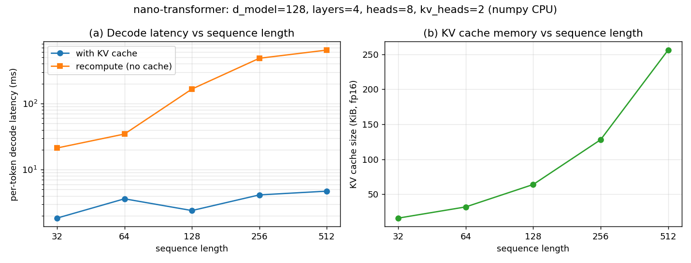

# 01-nano-transformer: results

Config: d_model=128, n_layers=4, n_heads=8, n_kv_heads=2, vocab_size=512, ffn_mult=2.0, max_seq_len=1024, rope_theta=10000.0. Seed 7; weights random-init (float32); CPU numpy.

## Numerical verification

| Check | Max abs diff | Status |
|---|---|---|
| RMSNorm vs naive loop | 4.768e-07 | pass (< 1e-06) |
| RoPE vs complex-exponential rotation | 2.384e-07 | pass (< 1e-05) |
| GQA vs full-head (tied weights) | 0.000e+00 | pass (== 0 (bit-exact)) |
| KV-cache decode vs full forward | 0.000e+00 | pass (< 1e-06) |

## Decode latency vs sequence length (median of 15 reps)

| seq_len | with KV cache (ms/token) | recompute, no cache (ms/token) | speedup |
|---|---|---|---|
| 32 | 1.844 | 21.243 | 11.5x |
| 64 | 3.614 | 34.564 | 9.6x |
| 128 | 2.399 | 165.936 | 69.2x |
| 256 | 4.140 | 485.117 | 117.2x |
| 512 | 4.718 | 645.682 | 136.8x |

## Prefill latency vs prompt length (median of 15 reps)

| prompt_len | prefill latency (ms) |
|---|---|
| 32 | 13.487 |
| 64 | 29.990 |
| 128 | 79.487 |
| 256 | 205.514 |
| 512 | 557.313 |

## KV cache memory vs sequence length (analytic, fp16)

Formula: 2 (k+v) * n_layers * n_kv_heads * head_dim * seq_len * 2 bytes.

| seq_len | KV cache bytes | KiB |
|---|---|---|
| 32 | 16,384 | 16.0 |
| 64 | 32,768 | 32.0 |
| 128 | 65,536 | 64.0 |
| 256 | 131,072 | 128.0 |
| 512 | 262,144 | 256.0 |

