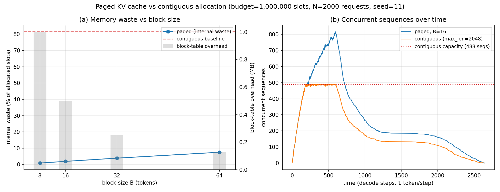

# 02-paged-kv — Paged KV-Cache Block Manager Simulator

A vLLM-style paged KV-cache block manager in numpy (CPU only) that quantifies
memory fragmentation waste against a naive contiguous allocator.

This is a **memory-management simulation with an analytical GPU-memory
model**: it simulates allocation policy (which slots each sequence gets),
not attention math and not real GPU execution. The "GPU memory budget" is a
fixed pool of 1M token slots; time is measured in abstract decode steps
(1 token per step).

## Problem

During autoregressive decoding, each sequence's KV cache grows token by
token, but its final length is unknown at admission. A serving system must
reserve GPU memory per sequence without knowing how much each will need.

## Current gap

The naive approach reserves the worst case (`max_len = 2048` slots) as one
contiguous run per sequence, placed with first-fit. Two costs follow:

1. **Internal fragmentation**: a 128-token sequence sits in a 2048-slot
   reservation; the unused slots are stranded until the sequence finishes.
2. **Wasted capacity**: those stranded slots cannot serve other sequences,
   so the server sustains far fewer concurrent requests than the memory
   could physically hold.

## Solution

`src/llm_inference_engine/paged_kv/` implements:

- `blocks.py` — `BlockManager`: the pool is split into fixed-size blocks
  (`B` tokens each); a sequence of `n` tokens takes `ceil(n / B)` blocks
  from a free list, recorded in a per-sequence block table. Blocks are
  fungible, so any free block serves any sequence. Plus
  `ContiguousAllocator`: the naive baseline, reserving `max_len` contiguous
  slots per sequence with first-fit placement and interval coalescing on
  free. Both expose identical accounting (`used_slots`,
  `allocated_slots`, `total_slots`, `fragmentation`).
- `workload.py` — `gen_workload`: 2000 requests; lengths from a 70/20/10
  mixture of N(128,32) / N(512,128) / N(2048,256), clipped to [1, 2048]
  (measured mean 373 tokens); arrivals uniform over 600 time steps;
  each sequence completes `length` steps after arrival.
- `experiments/run_experiments.py` — event-driven arrival/departure
  simulation through both allocators (seed `np.random.default_rng(11)`),
  the B sweep, charts, and `results/results.md`. The pipeline runs twice
  and asserts identical headline numbers before writing anything.

## Results

Experiment 1 — 1M-slot budget, 2000 requests (per-admission mean waste):

| allocator | internal waste % | external frag events | max concurrent seqs | admitted | rejected |
|---|---|---|---|---|---|
| paged (B=16) | 1.90 | 0 | 817 | 2000 | 0 |
| contiguous (max_len=2048) | 81.51 | 0 | 488 | 1397 | 603 |

Experiment 2 — block-size sweep (waste %, per-admission mean):

| B | paged waste % | contiguous waste % | paged block-table (MB) |
|---|---|---|---|
| 8 | 0.87 | 81.51 | 1.000 |
| 16 | 1.90 | 81.51 | 0.500 |
| 32 | 3.88 | 81.51 | 0.250 |
| 64 | 7.50 | 81.51 | 0.125 |



Headline: **paged B=16 wastes 1.90% vs 81.51% for contiguous, sustains 817
concurrent sequences vs 488, and rejects 0 of 2000 requests vs 603.**

## Insights

- **Paging converts a capacity problem into a rounding problem.** The
  contiguous baseline strands 2048 - length slots per sequence; paging
  strands only the unused tail of the last block (at most B - 1 slots).
  At B=16 that is 1.90% waste instead of 81.51%.
- **Waste is throughput.** The paged allocator admits all 2000 requests and
  peaks at 817 concurrent sequences; the contiguous allocator hard-caps at
  488 (1M / 2048) and rejects 603 requests — a 1.67x concurrency gap from
  memory management alone, with identical hardware.
- **Block size trades waste against table overhead, but the table is
  cheap in bytes.** Halving B roughly halves waste (7.50% at B=64 down to
  0.87% at B=8) while doubling the block table — yet even at B=8 the table
  is 1 MB against ~524 GB of KV memory (32 layers x 4096 hidden x fp16).
  In practice the small-block cost is kernel and bookkeeping complexity,
  not bytes; B=16 is the usual sweet spot.
- **No external fragmentation was observed for either allocator** in this
  workload: paged blocks are fungible by construction, and the baseline's
  uniform 2048-slot reservations mean every freed interval is itself a
  valid placement. The baseline's 603 rejections are pure internal
  fragmentation — memory that is free but reserved for sequences that will
  never use it.

## Reproduce

```bash
pip install -e .
python 02-paged-kv/experiments/run_experiments.py   # writes results/, asserts determinism
python 02-paged-kv/tests/test_smoke.py              # accounting invariants + determinism
```

Constraints: numpy + matplotlib only. No GPU, no network, no emojis.
