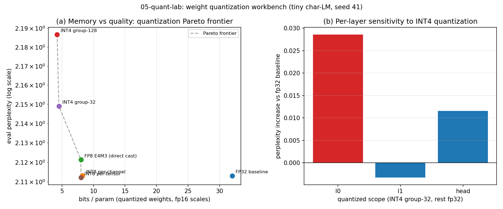

# 05-quant-lab: Weight Quantization Workbench

## Problem

Serving an LLM is dominated by moving weights from memory to compute: a 70B
model in fp16 needs ~140 GB just to hold the parameters, and every generated
token streams those weights through the chip again. Quantization -- storing
weights in INT8, FP8 or INT4 -- attacks that bottleneck directly, but every
scheme trades bits for model quality, and the *granularity* of the scheme
(per-tensor vs per-channel vs per-group) decides how gracefully it handles
the outlier weights real LLMs develop.

## Current gap

Most quantization write-ups either quote vendor numbers or show toy
round-trip error on random matrices. What is missing is a *closed loop* you
can run on a laptop: train a real (if tiny) language model from scratch,
quantize its actual trained weights with several schemes, and measure the
end-to-end effect on language modeling quality -- with every step seeded and
reproducible.

## Solution

`quant_lab` is a self-contained quantization workbench in numpy (CPU only):

- **`schemes.py`** -- symmetric per-channel INT8, per-tensor INT8 baseline,
  per-group symmetric INT4 (group sizes 32/128), and a faithful simulation of
  the OCP FP8 E4M3 grid (1 sign + 4 exponent + 3 mantissa bits, bias 7,
  saturating at +/-448, NaN pattern excluded). Each scheme returns
  dequantized float32 weights plus metadata (scales) and honest bit-rate
  accounting assuming fp16 scales.
- **`metrics.py`** -- relative L2 reconstruction error, SNR (dB), max-abs
  and mean-abs error.
- **`tiny_lm.py`** -- a minimal character-level transformer LM in pure
  numpy (d_model=64, 2 layers, 4 heads, d_ff=128, context 64, ~29-char
  vocab, ~74k params) with a handwritten forward/backward pass
  (finite-difference gradient-checked) and an Adam training loop.
- **`eval.py`** -- eval-set perplexity under quantization. Only Linear
  weight matrices are quantized; embeddings, norms and biases stay fp32
  (embeddings are lookups, not matmuls; norms/biases are <1% of params --
  the same split production pipelines use).

`experiments/run_experiments.py` (seeded `np.random.default_rng(41)`)
trains the LM once, then: (1) benchmarks reconstruction error on synthetic
weight matrices with LLM-like outlier structure; (2) evaluates perplexity
per scheme -- running the full eval sweep **twice** (weights reloaded from
disk) to prove determinism; (3) sweeps per-layer sensitivity with INT4.

## Results

All numbers below are measured on this machine (CPU, numpy), seed 41 --
not vendor claims, not estimates. The eval sweep ran twice with
bit-identical perplexities (weights reloaded from disk for pass 2), so the
perplexity table is deterministic, not sampling noise.

**Experiment 1 -- reconstruction error on outlier-structured weights**
(weights ~ N(0, 0.03) + 0.2% of entries x25 + ~1.5% outlier columns x12):

| shape | scheme | rel. L2 error | max-abs error | bits/param |
|---|---|---|---|---|
| 1024x1024 | INT8 per-channel | 0.0491 | 0.0773 | 8.016 |
| 1024x1024 | FP8 E4M3 (direct cast) | 0.0323 | 0.5009 | 8.000 |
| 1024x1024 | INT4 group-128 | 0.2274 | 0.7894 | 4.125 |
| 1024x1024 | INT4 group-32 | 0.1317 | 0.3709 | 4.500 |
| 1024x1024 | INT8 per-tensor | 0.3736 | 0.0777 | 8.000 |
| 4096x1024 | INT8 per-channel | 0.0466 | 0.0967 | 8.016 |
| 4096x1024 | FP8 E4M3 (direct cast) | 0.0337 | 0.9809 | 8.000 |
| 4096x1024 | INT4 group-128 | 0.2302 | 0.8872 | 4.125 |
| 4096x1024 | INT4 group-32 | 0.1334 | 0.6129 | 4.500 |
| 4096x1024 | INT8 per-tensor | 0.3864 | 0.0979 | 8.000 |

**Experiment 2 -- trained-model perplexity** (600-step Adam, final train
loss 0.4724, eval on held-out 10% of corpus):

| scheme | eval perplexity | bits/param |
|---|---|---|
| FP32 baseline | 2.1130 | 32.000 |
| INT8 per-channel | 2.1131 | 8.220 |
| FP8 E4M3 (direct cast) | 2.1212 | 8.000 |
| INT4 group-128 | 2.1867 | 4.220 |
| INT4 group-32 | 2.1490 | 4.500 |
| INT8 per-tensor | 2.1121 | 8.003 |

**Experiment 3 -- per-layer sensitivity** (INT4 group-32, one scope at a
time, rest fp32):

| quantized scope | eval perplexity | delta vs baseline |
|---|---|---|
| l0 (first block) | 2.1416 | +0.0286 |
| l1 (second block) | 2.1098 | -0.0033 |
| head | 2.1246 | +0.0116 |

## Insights

1. **Granularity is about outliers, not averages.** On outlier-structured
   weights, per-tensor INT8 has ~8x worse relative-L2 error than
   per-channel INT8 (0.37-0.39 vs 0.047-0.049): one hot channel forces a
   huge global scale, crushing the many small weights, while max-abs error
   barely differs. On the tiny trained model -- which developed no strong
   outlier channels -- per-tensor and per-channel tie at 8 bits. The
   synthetic experiment isolates the mechanism; the trained-model
   experiment shows when it does and does not bite.
2. **FP8 has a split personality.** The log-spaced E4M3 grid fits the
   bell-shaped bulk of weights beautifully (best rel-L2 of all schemes at
   0.032) but quantizes large magnitudes coarsely (worst max-abs error,
   0.50-0.98). As an *unscaled* direct cast on trained weights it still
   cost only +0.008 perplexity -- tiny-model weights live inside FP8's
   comfort zone (2^-9..448). This is also why production FP8 always pairs
   the format with a scale: without one, any weight below ~2^-9 flushes to
   zero.
3. **INT4 granularity is a clean rate/quality knob.** Shrinking the group
   128 -> 32 nearly halved the perplexity penalty (+0.074 -> +0.036) for
   +0.28 bits/param -- the knee of the Pareto frontier sits at INT4-g32.
4. **Early layers are the sensitive ones.** Quantizing only the first
   transformer block cost +0.029 perplexity; the second block was
   effectively immune (-0.003, i.e. noise). A mixed-precision recipe would
   spend its bit budget on early layers first.
5. **INT8 is effectively lossless here** (delta < 0.001, within eval
   noise on a ~1.2k-char eval set) -- the honest claim is the tie, not the
   ranking between per-tensor and per-channel.

Full tables: [`results/results.md`](results/results.md).

## Scale limits

Tiny model (~74k params), character-level, CPU, synthetic repetitive text.
The *methodology* -- granularity ablations, Pareto analysis, sensitivity
sweeps, seeded determinism checks -- transfers directly to real LLMs; the
absolute perplexities do not. INT4/INT8 kernels, activation quantization and
calibration datasets are out of scope for this workbench.
